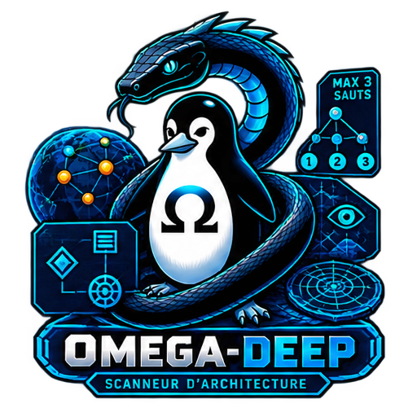

<!-- Copyright (c) 2026 kraynux - kraynux@proton.me - Licencja MIT (zobacz plik LICENSE) -->
<div align="center">
  
</div>

# 🖧 OMEGA-DEEP

**Analiza architektury wielu celów (odkrywanie + zabezpieczenia + graf)**

> Stworzone przez **kraynux** dla **Omega-server** 
[https://kraynux.snake-mackarel.ts.net](https://kraynux.snake-mackarel.ts.net)

Oficjalna strona: [OMEGA-DEEP](https://kraynux.snake-mackarel.ts.net/omega-deep/) &nbsp; Podgląd: [Screenshots](https://kraynux.snake-mackarel.ts.net/omega-deep/screenshots/)  

[](../../../LICENSE)
[](https://www.python.org/)
[](https://www.linux.org/)
[](https://github.com/Textualize/rich)

🌐 Interfejs i eksportowane raporty dostępne w **17 językach** — zobacz [Języki interfejsu](#języki-interfejsu).  
**Języki:**  
 [Français](../../../README.md) ·  [English](../en/README.md) ·  [Español](../es/README.md) ·  [Português (Brasil)](../pt-BR/README.md) ·  [Italiano](../it/README.md) ·  [Deutsch](../de/README.md) ·  [Nederlands](../nl/README.md) ·  [Polski](README.md) ·  [Русский](../ru/README.md) ·  [中文](../zh-CN/README.md) ·  [Tiếng Việt](../vi/README.md) ·  [ไทย](../th/README.md) ·  [Bahasa Indonesia](../id/README.md) ·  [日本語](../ja/README.md) ·  [한국어](../ko/README.md) ·  [हिन्दी](../hi/README.md) ·  [العربية](../ar/README.md)

---

**Omega-deep** robi wszystko to, co `omega-check` na pojedynczym celu (skan portów, rozpoznawanie usług, role, WAF, TLS), i dodaje **odkrywanie kolejnych celów** na podstawie wskazówek pozostawionych przez już przeskanowany cel (nagłówki, przekierowania, certyfikat, odnośniki HTML), w granicach **ścisłych zabezpieczeń** i z **wyraźnym zatwierdzeniem przez użytkownika** przed skanem dowolnego odkrytego celu, a następnie **odtwarza graf architektury** (kto z kim się komunikuje i z jaką pewnością). Narzędzie pakietu `omega-`, zbudowane zgodnie z Clean Architecture — pełne szczegóły techniczne w `docs/ARCHITECTURE.md`.

## 1. Wizja i zakres

Omega-deep odpowiada na pytanie, którego omega-check nie zadaje: *co jeszcze kryje się za tym adresem IP?* Odwrotne proxy ogłaszające swój backend, certyfikat obejmujący kilka hostów, strona wskazująca sąsiednią usługę — to wszystko wskazówki, za którymi omega-deep podąża ostrożnie i nigdy na własną rękę.

### Co robi Omega-deep

- Skanuje cel główny dokładnie tak jak omega-check (profil systemowy lub zapisany profil własny).
- Odkrywa cele kandydujące na podstawie wskazówek pozostawionych przez każdy już przeskanowany host: nagłówki HTTP (`X-Forwarded-Host`, `X-Real-IP`, `X-Backend-Server`, `Via`), przekierowanie (`Location`), certyfikat TLS (SAN), odnośniki HTML — zobacz [§4](#4-odkrywanie-celów-i-zabezpieczenia).
- **Nigdy** nie skanuje odkrytego celu bez wyraźnego zatwierdzenia, cel po celu — milczenie nigdy nie oznacza zgody.
- Ogranicza odkrywanie ścisłymi zabezpieczeniami: maksymalna głębokość, maksymalna liczba dodatkowych celów, dozwolona podsieć (domyślnie ten sam prywatny zakres co cel główny).
- Odtwarza **graf architektury** na podstawie pochodzenia każdego zaakceptowanego celu (`proxy_to`, `redirect_to`, `linked_to`), z poziomem pewności dla każdej relacji — zobacz [§8](#8-graf-architektury).
- Przedstawia wynik w TUI (Textual) lub w skryptowalnym CLI, z tymi samymi trzema eksportami co omega-check (JSON, tekst, HTML z 5 motywami) — graf jest tam **prawdziwym rysowanym diagramem** w HTML, a nie tabelą.
- Nadaje każdej zebranej informacji (o usłudze czy z odkrywania) wyraźny poziom pewności — zobacz [§9](#9-zasady-pewności).
- Prowadzi trwałą historię analiz, którą można odtwarzać i porównywać w czasie.

### Czego Omega-deep nie robi

- Aktywnego skanowania podatności: bez SQLi, XSS czy RCE.
- Skanowania CVE.
- Rozpoznawania systemu operacyjnego.
- Niskopoziomowych technik skanowania w stylu nmap (skan SYN, surowe pakiety) — tylko połączenie TCP na poziomie aplikacji.
- Narzędzia do brute force ani fuzzingu.
- Skanowania odkrytego celu bez wyraźnego potwierdzenia użytkownika — nigdy, w żadnym trybie.
- Odkrywania poza prywatną podsiecią celu początkowego, chyba że skonfigurowano to wprost (`--subnet`).
- Panelu WWW.

## 2. Instalacja

### Wymagania

- Python 3.10+
- Połączenie z Internetem, dla zależności

### Instalacja

```bash
[ -d omega-deep ] && echo "ℹ️ Już tu rozpakowano, krok pominięty." || tar -xzf omega-deep.tar.gz
cd omega-deep/
chmod +x install.sh
./install.sh
```

`install.sh`:

1. Tworzy środowisko wirtualne `.venv`, jeśli jeszcze nie istnieje.
2. Instaluje zależności (`vendor/omega-lib/`, a potem `pip install -e .`; `pyproject.toml` pozostaje jedynym źródłem prawdy).
3. Nadaje plikom `omega-deep.sh` i `install.sh` prawo wykonywania.
4. Dodaje alias `deep` do `~/.bashrc` i `~/.zshrc` (bez duplikatu, jeśli już istnieje).

### Zależności

Zadeklarowane w `pyproject.toml` (już bez `requirements.txt`):
- `omega-lib`: wspólna biblioteka pakietu (`ConfidenceLevel`, motywy, wykrywanie terminala) — dołączona w `vendor/omega-lib/`
- `textual`: interfejs TUI, motywy, automatyczne dopasowanie do terminala
- `httpx`: sondy HTTP/HTTPS (usługa i odkrywanie)
- `cryptography`: odczyt wynegocjowanego certyfikatu TLS
- `jinja2`: szablony dla eksportu HTML
- Zależności deweloperskie (`pip install -e ".[dev]"`): `pytest`, `pytest-asyncio`, `pytest-cov`, `pytest-httpserver`, `trustme`, `ruff`, `mypy`, `import-linter`

## 3. Użycie

### Tryb interaktywny (TUI)

Zalecany do codziennego użytku — uruchamiany bez argumentów:

```bash
./omega-deep.sh
```
jeśli utworzono alias, wystarczy wpisać `deep` w terminalu:
```bash
deep
```

Przebieg: ekran startowy (zamyka się klawiszem lub kliknięciem) → menu główne (Analizuj / Profile / Historia / Ustawienia / Pomoc) → wprowadzenie celu głównego, wybór profilu i zabezpieczeń odkrywania (maks. głębokość, maks. liczba celów, dozwolona podsieć) → analiza (nieokreślony wskaźnik postępu i bieżący dziennik operacji sieciowych) → dla każdej partii odkrytych celów ekran zatwierdzania (jeden wiersz na cel, ze źródłem/pewnością/dowodem, przełącznik akceptuj/odrzuć — domyślnie nic nie jest zaznaczone) → szczegóły analizy (hosty, porty/usługi/role, graf, eksport) → historia/porównanie/ponowne uruchomienie i ustawienia z menu głównego. Dopasowanie do terminala (kolory, rozmiar, uproszczenie struktury) jest automatyczne.

#### Skróty klawiszowe

| Klawisz | Działanie |
|---|---|
| `↑` / `↓` | Przechodzenie między elementami ekranu |
| `Tab` / `Shift+Tab` | Przechodzenie między polami formularza |
| `Esc` | Powrót do poprzedniego ekranu (potwierdzenie wyjścia na ekranie głównym) |
| `t` | Następny motyw (stosowany od razu, bez potwierdzenia) |
| `r` | Odświeżenie wykrywania terminala |
| `a` | Wyświetlenie pomocy |
| `q` | Wyjście (z potwierdzeniem) |

### Języki interfejsu

Interfejs jest dostępny w 17 językach: francuskim, angielskim, hiszpańskim, portugalskim (Brazylia), włoskim, niemieckim, niderlandzkim, polskim, rosyjskim, chińskim uproszczonym, wietnamskim, tajskim, indonezyjskim, japońskim, koreańskim, hindi i arabskim. Wyboru dokonuje się w Ustawieniach („Langue / Language”), a zmiana obowiązuje po ponownym uruchomieniu interfejsu; zmienna `OMEGA_DEEP_LANG` (na przykład `OMEGA_DEEP_LANG=pl ./omega-deep.sh`) wymusza język na czas jednej sesji. Uruchomiony z omega-suite, omega-deep przejmuje język pakietu. W tekstowej konsoli Linuksa (TTY) języki o piśmie innym niż łacińskie są na czas sesji wyświetlane po angielsku. Wiersz poleceń pozostaje po francusku.

### Tryb skryptowy (CLI)

Każde podpolecenie włącza tryb CLI:

```bash
# Analiza celu (skan celu głównego + odkrywanie wielu celów)
./omega-deep.sh analyze 192.168.1.10 --profile web --max-depth 3 --max-targets 10 --subnet 192.168.1.0/24

# Historia (z filtrowaniem według celu głównego)
./omega-deep.sh history --target 192.168.1.10 --limit 20

# Szczegóły analizy (tekst, JSON lub HTML) — do wyboru 5 motywów eksportu
./omega-deep.sh show <scan_id> --format html --theme omega-base --output raport.html

# Porównanie dwóch analiz (stan portów celu głównego)
./omega-deep.sh compare <scan_id_a> <scan_id_b>

# Własne profile portów
./omega-deep.sh profile list
./omega-deep.sh profile create lab --ports 22,80,443 --description "Mój profil"
./omega-deep.sh profile edit lab --ports 22,80,443,8080
./omega-deep.sh profile pin lab
./omega-deep.sh profile unpin lab
./omega-deep.sh profile delete lab
```

W CLI odkryte cele zatwierdza się, odpowiadając na jedno interaktywne pytanie na cel (`Scanner <cible> ? [o/N]`, po francusku jak reszta wiersza poleceń), a przed każdym pytaniem wyświetlany jest dowód. `--auto-validate` akceptuje wszystko bez przeglądu (**odradzane**, wyświetlane jest ostrzeżenie); w środowisku nieinteraktywnym (brak TTY i brak `--auto-validate`) każdy odkryty cel jest domyślnie odrzucany, zamiast być skanowanym bez potwierdzenia.

### Akceptowane formaty celu

```text
192.168.1.10                IPv4
example.org                 Nazwa hosta
http://example.org          URL HTTP  (schemat usuwany przed rozwiązaniem nazwy)
https://example.org:8443    URL HTTPS z portem  (schemat i port usuwane)
```

Schemat i ewentualny port są usuwane przed rozwiązaniem DNS (`domain/targets/validation.py::normalize_target_input`) — wklejenie całego URL działa, zachowywany jest tylko host. Cele *odkryte* są normalizowane w ten sam sposób, ale nigdy nie są skanowane bez zatwierdzenia (zobacz [§4](#4-odkrywanie-celów-i-zabezpieczenia)).

## 4. Odkrywanie celów i zabezpieczenia

### Źródła wskazówek

| Źródło | Pochodzenie | Pewność |
|---|---|---|
| `header` | `X-Forwarded-Host`, `X-Real-IP`, `X-Backend-Server`, `Via` | `DECLARED` |
| `redirection` | Nagłówek `Location` odpowiedzi HTTP | `DECLARED` |
| `certificate` | SAN (Subject Alternative Names) wynegocjowanego certyfikatu TLS | `DECLARED` |
| `html_link` | Odnośniki (`<a href>`) serwowane przez stronę | `INFERRED` |

Wartość `DECLARED` pozostaje samodeklaracją celu (do sfałszowania) — zobacz [§10](#10-ochrona-przed-sfałszowanymi-wartościami). `html_link` jest celowo najsłabszym źródłem: zwykły odnośnik nie deklaruje żadnej relacji infrastrukturalnej.

### Zabezpieczenia (zawsze aktywne, nigdy niewyłączalne)

- **Obwód**: cel kandydujący musi być prywatnym adresem IP w tej samej sieci `/24` co cel główny, chyba że podano wprost `--subnet` (wtedy liczy się tylko przynależność do wskazanej podsieci, nawet jeśli obejmuje publiczne adresy IP — to wyraźna konfiguracja dopuszcza wyjątek). Nierozwiązana nazwa hosta nigdy nie jest akceptowana przez ten filtr (rozwiązanie jej w celu sprawdzenia byłoby już działaniem sieciowym wykraczającym poza tę kontrolę).
- **Głębokość**: `--max-depth` (domyślnie 3) — maksymalnie A → B → C → D.
- **Liczba celów**: `--max-targets` (domyślnie 10) — łącznie na wszystkich głębokościach.

### Zatwierdzanie (nigdy skan bez potwierdzenia)

Każdy proponowany cel przechodzi `PROPOSED → PRESENTED → ACCEPTED` lub `REJECTED`. Zasada jest **bezpieczna w razie awarii**: każdy cel nigdy wyraźnie nie zaakceptowany (milczenie, zamknięcie ekranu, przerwanie, przekroczenie czasu, brak TTY) jest traktowany jako odrzucony — nigdy odwrotnie. W TUI osobny ekran wyświetla cele z partii wraz z dowodem i pewnością, przełącznik akceptuj/odrzuć w każdym wierszu, „akceptuj wszystko”/„odrzuć wszystko” oraz domyślne odrzucenie wszystkiego klawiszem Esc. W CLI jedno pytanie na cel; `--auto-validate` (odradzane) to jedyny sposób na obejście interaktywności.

## 5. Profile skanowania

| Profil | Opis | Przypięty |
|---|---|---|
| `minimal` | Bardzo szybki skan: SSH + HTTP + HTTPS (22, 80, 443) | tak |
| `classic` | Klasyczne usługi Internetu/LAN | tak |
| `web` | Usługi WWW i alternatywne | nie |
| `db` | Bazy danych i usługi danych | nie |
| `remote` | Dostęp zdalny — powłoka, pulpit, RustDesk | nie |
| `mail` | Usługi pocztowe | nie |
| `dns` | Usługi DNS | nie |
| `iot` | Urządzenia IoT, kamery, routery, automatyka domowa | nie |
| `dev` | Środowiska deweloperskie/laboratoryjne | nie |
| `docker` | Docker, Swarm i typowe usługi w kontenerach | nie |
| `complet` | **Generowany na bieżąco**: posortowana suma wszystkich powyższych profili, bez duplikatów | nie |
| *profil własny* | Utworzony na ekranie **Profile** (TUI) lub poleceniem `profile create` (CLI), wyświetlany obok profili systemowych, w TUI poprzedzony `* ` | nie |

Profil dotyczy celu głównego **i** każdego zaakceptowanego odkrytego celu — bez osobnego profilu dla każdego hosta. Pełne szczegóły, zasady walidacji i zarządzanie własnymi profilami: `docs/PROFILES.md`.

## 6. Architektura

Omega-deep jest zbudowany zgodnie z **Clean Architecture** (domain / application / infrastructure / interfaces / ports / core / app / plugins / shared), wzorowaną na szablonie pakietu `omega-` (zobacz `omega-scan`/`omega-check`) i sprawdzaną przez `import-linter` przy każdej zmianie. Wszystkie szczegóły znajdują się w **`docs/ARCHITECTURE.md`**.

Bardzo krótki przegląd:

```text
src/omega_deep/
├── domain/          Czysta logika biznesowa: skany, cele, usługi, profile, raporty,
│                    discovery (proponowane cele, maszyna stanów zatwierdzania),
│                    architecture (graf, reguły relacji)
├── application/     Przypadki użycia (commands/queries) — m.in. discover_targets,
│                    validate_targets, reconstruct_architecture (nowe względem omega-check)
├── ports/           Kontrakty oczekiwane przez aplikację (sondy, m.in. discovery_prober,
│                    repozytoria, eksportery...)
├── infrastructure/  Konkretne implementacje (socket/httpx/cryptography, SQLite,
│                    rysowanie grafu w SVG — Textual NIE jest tutaj)
├── interfaces/      tui/ (Textual) i cli/ (skryptowalne), ze ścisłą równością funkcji
├── app/             Składanie (DependencyContainer, bootstrap, cykl życia)
├── core/, shared/   Wspólne słownictwo, narzędzia niezwiązane z logiką biznesową
└── plugins/         Struktura przygotowana, pusta (brak potwierdzonej osi rozszerzeń)
```

Zasady projektowe:
- `domain/services/policies.py`: klasyfikuje już zebrane wskazówki, nigdy nie korzysta z sieci.
- `domain/discovery/policies.py`: zabezpieczenia obwodu/głębokości/liczby — czysta logika, testowalna bez sieci.
- `domain/architecture/service.py`: odtwarza graf z pochodzenia, które już niesie każdy `Host`, nie wykonuje żadnego nowego żądania.
- `infrastructure/network/` i `infrastructure/discovery/`: korzystają z sieci (gniazda, `httpx`, `cryptography`), nigdy nie oceniają.
- `interfaces/`: wyświetla, nie zawiera żadnej logiki biznesowej — ekran zatwierdzania odkrytych celów wywołuje `validate_targets`, nie implementuje sam zasady bezpieczeństwa w razie awarii.
- `infrastructure/exporters/`: czytają wynik analizy (skan, hosty, graf), niczego nie przeliczają.

## 7. Rozpoznawanie usług i role

### Wykrywane protokoły

| Protokół | Sonda | Zbierane szczegóły |
|---|---|---|
| HTTP / HTTPS | `httpx` | Baner `Server`, nagłówki uwierzytelniania |
| TLS | `cryptography` (wynegocjowany certyfikat, łącznie z `CERT_NONE`) | Wersja, szyfr, podmiot/wystawca certyfikatu |
| SSH | Surowy baner | Oprogramowanie i wersja (np. `OpenSSH 10.4`) |
| VNC (RFB) | Kody bezpieczeństwa ogłaszane przez serwer | Obsługiwane rodzaje uwierzytelniania |
| Ogólny | Surowy baner na nierozpoznanym otwartym porcie | Ostrożna ekstrakcja, bez agresywnej heurystyki |

### Wnioskowane role

Wyprowadzane z **faktycznie wynegocjowanego** protokołu, nigdy z przypuszczenia na podstawie numeru portu:

| Rola | Warunek | Pewność |
|---|---|---|
| `serwer WWW` | Potwierdzony protokół HTTP/HTTPS | `INFERRED` |
| `dostęp do powłoki` | Potwierdzony protokół SSH | `CORROBORATED` |
| `dostęp graficzny` | Potwierdzony protokół VNC | `CORROBORATED` |
| `baza danych` | Port w zakresie profilu systemowego `db` | `INFERRED` |

### Znane sygnatury WAF

Wykrywane na podstawie nagłówka deklaratywnego (`server`, `x-sdk`) — obecność **zadeklarowana przez cel**, nigdy niezależnie weryfikowana: Cloudflare, Sucuri, Akamai, Imperva Incapsula, AWS ELB (wymieniony informacyjnie, nie jest to ściśle WAF aplikacyjny).

## 8. Graf architektury

Odtwarzany wyłącznie na podstawie pochodzenia, które już niesie każdy zaakceptowany host (`discovered_from`/`discovery_source`/`discovery_confidence`) — bez nowego żądania sieciowego i bez ponownej analizy surowych wskazówek.

### Tworzone relacje

| Relacja | Źródło odkrycia | Znaczenie |
|---|---|---|
| `proxy_to` | `header` | Cel główny (lub już zaakceptowany host) jest prawdopodobnie proxy do odkrytego celu |
| `redirect_to` | `redirection` | Zaobserwowane przekierowanie HTTP do odkrytego celu |
| `linked_to` | `certificate` lub `html_link` | Najbardziej neutralna relacja — wspólna infrastruktura/aplikacja, bez stwierdzania kierunku przepływu |

`backend_of` (krawędź odwrotna do `proxy_to`) celowo nie jest tworzona — byłaby powieleniem informacji, a nie nowym wnioskiem.

### Prezentacja

- **TUI** (szczegóły analizy) oraz **eksporty JSON/tekst**: lista krawędzi (źródło, relacja, cel, pewność) — terminal nie jest miejscem na bogatą prezentację graficzną.
- **Eksport HTML**: **prawdziwy diagram SVG** (węzły = koła, krawędzie = podpisane strzałki), układ warstwowy liczony od celu głównego, rozmiar proporcjonalny do liczby odkrytych maszyn — nigdy ciężka zależność do układania grafów; graf z założenia pozostaje mały (ograniczony zabezpieczeniami z [§4](#4-odkrywanie-celów-i-zabezpieczenia)).

## 9. Zasady pewności

Każde zebrane pole ma jeden z tych poziomów:

| Poziom | Znaczenie |
|---|---|
| `VERIFIED` | Fakt protokołowy zaobserwowany bezpośrednio, którego cel nie może sfałszować (np. zamknięty port potwierdzony przez TCP RST, faktycznie wynegocjowana wersja TLS). |
| `DECLARED` | Wartość ogłoszona przez sam cel w polu, które w pełni kontroluje (np. baner `Server`, nagłówek `X-Backend-Server`) — wiarygodna, ale dowolnie fałszowalna. |
| `CORROBORATED` | Wartość `DECLARED` potwierdzona niezależną wskazówką (np. rola SSH, ponieważ protokół faktycznie został wynegocjowany). |
| `INFERRED` | Wyprowadzona z wzorca/heurystyki, bez wyraźnej deklaracji celu (np. odnośnik HTML). |
| `UNKNOWN` | Brak użytecznej wskazówki lub aktywnie ukryte przez cel. |

## 10. Ochrona przed sfałszowanymi wartościami

Omega-deep nie ufa żadnym danym zadeklarowanym przez sam cel, nie zaznaczając tego wyraźnie — a odkrywanie celów to najbardziej wrażliwa część projektu: złośliwy cel *mógłby* ogłosić fałszywy `X-Backend-Server`, aby skierować odkrywanie na wybrany przez siebie adres IP. Dwie strukturalne ochrony, niezależne od siebie:
- Żadna informacja pochodząca od celu nigdy nie jest `VERIFIED` tylko dlatego, że została ogłoszona — baner `Server` czy nagłówek `X-Backend-Server` pozostaje `DECLARED`, bez względu na wiarygodność.
- Zabezpieczenie obwodu ([§4](#4-odkrywanie-celów-i-zabezpieczenia)) ogranicza, dokąd może prowadzić ogłoszony cel (ta sama prywatna sieć `/24`, chyba że skonfigurowano inaczej), a zatwierdzenie przez użytkownika decyduje, czy w ogóle zostanie przeskanowany — fałszywy cel poza obwodem nigdy nie jest nawet proponowany; cel w obwodzie nadal wymaga wyraźnego potwierdzenia przed jakimkolwiek skanem.

## 11. Zgodność z terminalami

TUI (Textual) automatycznie wykrywa możliwości terminala (emulator, rozmiar) i odpowiednio dostosowuje swój strukturalny arkusz stylów (`complete`/`standard`/`reduced`/`mono`), bez ręcznej opcji. Tryb CLI zawsze pozostaje zwykłym tekstem, niezależnie od terminala. Zasada wspólna dla całego pakietu `omega-` (`omega-lib`, `terminal/policies.py`).

### Profil według wykrytego emulatora

| Emulator | Profil początkowy |
|---|---|
| Ghostty, Alacritty, WezTerm, Kitty | `complete` |
| Konsole, GNOME Terminal, Terminator, Xfce4 Terminal | `standard` |
| xterm, urxvt, nowoczesne SSH | `reduced` |
| TTY Linuksa, starsze SSH | `mono` |
| Nierozpoznany emulator | `reduced` (domyślna wartość zapasowa) |

### Profil według rozmiaru terminala

| Minimalny rozmiar (kolumny × wiersze) | Górna granica profilu |
|---|---|
| 120 × 32 | `complete` |
| 100 × 28 | `standard` |
| 80 × 24 | `reduced` |
| poniżej | `mono` |

Ostateczny profil to **bardziej restrykcyjny z dwóch** (emulator i rozmiar) — Ghostty na pełnym ekranie zmniejszony do 70 kolumn spada do `mono`, choć jego emulator pozwalałby na `complete`. Można go odświeżyć na bieżąco klawiszem `r`.

## 12. Eksporty

Raporty tekstowe i HTML są zapisywane w języku wybranym w Ustawieniach („Język eksportów”, domyślnie język interfejsu); JSON pozostaje danymi i nie jest tłumaczony. Raporty są domyślnie tworzone w `var/exports/` (ścieżka robocza zakotwiczona w folderze projektu, `$OMEGA_DEEP_VAR_DIR`, aby ją zmienić) albo pod wskazaną ścieżką (`--output` w CLI, okno dialogowe w TUI). Jednoznaczna nazwa pliku ze znacznikiem czasu: `analyse-{profil}-{data}.ext`, `analyse-custom-{data}.ext` dla profilu własnego.

### JSON, źródło prawdy

Pełna struktura analizy (`Scan` + `Host[]` + `ArchitectureGraph`), ściśle serializowalna do JSON, łącznie z poziomami pewności.

### Tekst, zwięzły raport do czytania

Czytelny poza terminalem, bez kodów ANSI — graf jako lista krawędzi.

### HTML, samodzielny raport WWW

5 motywów do wyboru (`--theme` w CLI, wybór w TUI; domyślnie podąża za aktywnym motywem interfejsu, jeśli istnieje odpowiednik). Własny układ: kontener, siatka informacji, ramki statystyk według stanu portu, kolorowe odznaki, **diagram SVG grafu architektury** (zobacz [§8](#8-graf-architektury)) — ta sama rodzina wizualna co `omega-scan`/`omega-check`.

## 13. Historia i porównanie

Każda analiza jest zapisywana (SQLite, `var/db/omega-deep.db`): jeden `scan_id` obejmuje cel główny **oraz** wszystkie odkryte/zaakceptowane hosty, a także odtworzony graf. Historia przeglądana według celu głównego (z osobną kolumną na liczbę odkrytych celów), szczegóły dawnej analizy (hosty + graf), porównanie dwóch analiz (stan portów wyłącznie **celu głównego** — porównywanie grafów odkrywania byłoby możliwym rozszerzeniem, na razie zbędnym) i ponowne uruchomienie analizy na tym samym celu głównym bez ponownego wpisywania.

## 14. Testy

```bash
source .venv/bin/activate
lint-imports        # sprawdza Dependency Rule
pytest -q           # 191 testów
ruff check src tests
mypy -p omega_deep
```

Struktura: `tests/unit/` (domena i aplikacja, bez prawdziwych operacji wejścia/wyjścia), `tests/integration/` (prawdziwe SQLite/pliki, pozorowany serwer HTTP `pytest-httpserver`, TLS przez `trustme`), `tests/tui/` (nawigacja przez `Pilot`, strukturalna — bez samozwańczej weryfikacji wizualnej).

## 15. Poza zakresem

- Skanowanie CVE
- Aktywne wykrywanie SQLi, XSS, RCE
- Rozpoznawanie systemu operacyjnego
- Niskopoziomowe techniki skanowania w stylu nmap (skan SYN, surowe pakiety)
- Crawling
- Fuzzing
- Brute force
- Skanowanie odkrytego celu bez wyraźnego potwierdzenia — nigdy, w żadnym trybie
- Odkrywanie poza prywatną podsiecią celu początkowego bez wyraźnej konfiguracji
- Panel WWW

---

> Omega-deep — Odkrywać, mapować, oceniać, raportować.
> Architektura odtworzona z wyraźnie określoną pewnością, nigdy przypuszczenie przebrane za fakt.
